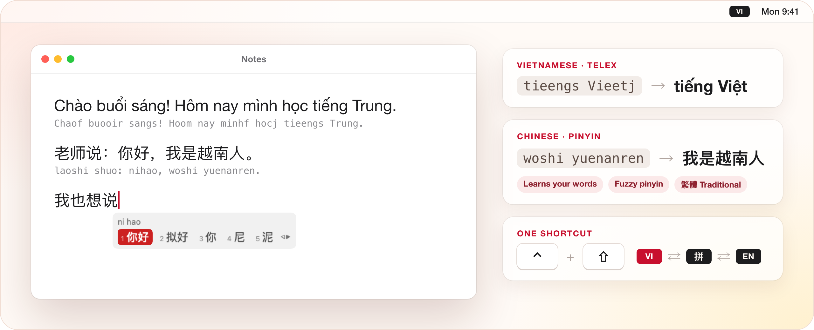
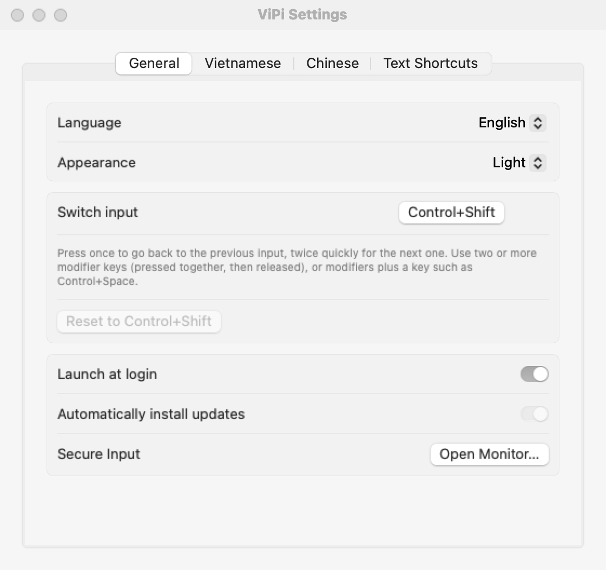
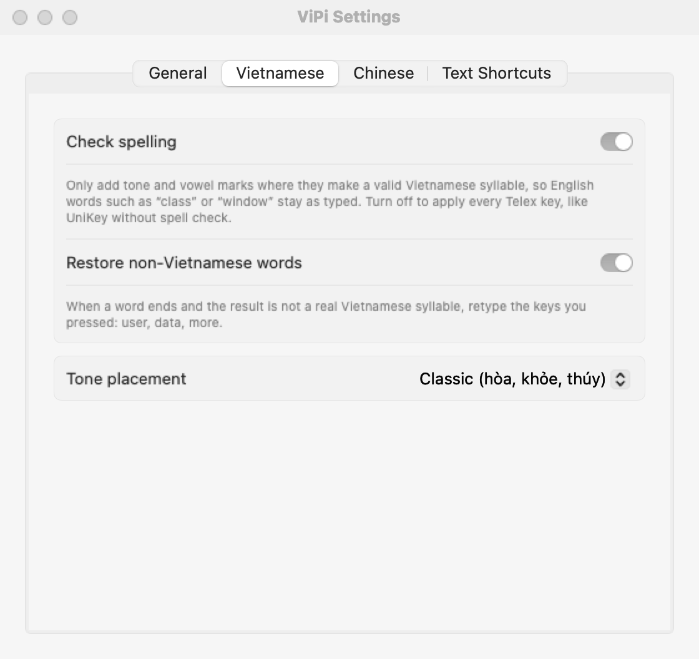
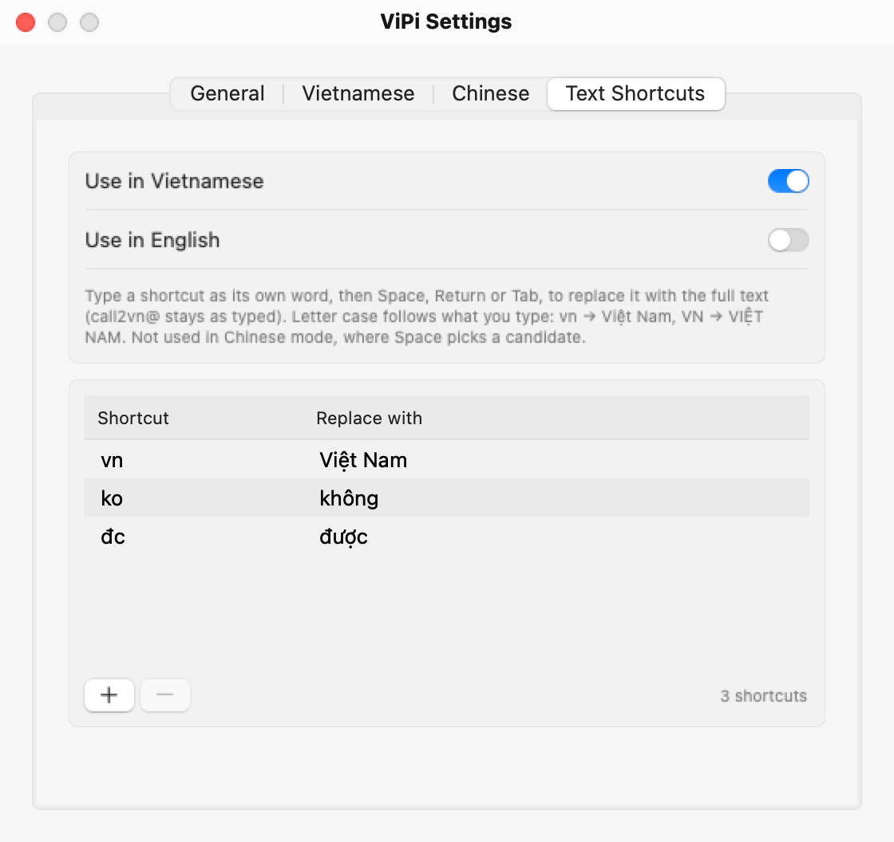

<h1 align="center">ViPi</h1>

  <b>Vietnamese and Chinese on one Mac keyboard. One shortcut to switch.</b> 
  Telex + Pinyin in a tiny menu-bar app. Free, open source, 100% offline.

  
  
  
  
  

  

<b>English</b> · <a href="README.vi.md">Tiếng Việt</a> · <a href="README.zh-CN.md">简体中文</a>

  <picture>
    <source media="(prefers-color-scheme: dark)" srcset="assets/readme/hero-dark.png">
    
  </picture>

---

## 🤔 Why ViPi?

If you write in Vietnamese and Chinese, your Mac probably looks like this:

- ❌ A Vietnamese input tool, Apple Pinyin and ABC: **three input sources and two tools** fighting over the keyboard
- ❌ ⌃Space cycles through all of them, so you **press it again and again** to land on the right one
- ❌ English words turn into Vietnamese in the middle of a sentence
- ❌ One day every input tool **stops working** and nothing tells you why

**ViPi fixes all of it:**

- ✅ **One app, one shortcut.** `⌃ Control` + `⇧ Shift` jumps straight back to the language you used last
- ✅ **English stays English.** `user`, `data`, `class` come out exactly as typed, no switching needed
- ✅ **Pinyin at the cursor.** Candidates appear right where you type, and whole sentences convert at once
- ✅ **No more mystery freezes.** The Secure Input Monitor names the app that is blocking your keyboard

## ⚡ Get started in under a minute

1. **[Download ViPi.dmg](../../releases/latest/download/ViPi.dmg)**, open it and drag **ViPi** onto **Applications**.
2. Open ViPi and allow it in **System Settings → Privacy & Security → Accessibility**. It starts working within 2 seconds.
3. Press **`⌃ Control` + `⇧ Shift`** and start typing. 🎉

> **Tip:** turn off other Vietnamese input tools (UniKey, EVKey, GoNhanh…) and keep the plain **ABC** input source, so only ViPi changes what you type.

## ✨ Features

### 🇻🇳 Vietnamese Telex that keeps up with you

| You type | You get | |
|:--|:--|:--|
| `tieengs Vieetj` | **tiếng Việt** | UniKey-style Telex: `aa` `aw` `ee` `oo` `ow` `uw` `dd`, tones `s f r x j` |
| `tosan` | **toán** | type the tone anywhere in the word |
| `ass` | **as** | press a key twice to undo it |
| `user data class` | **user data class** | English words are restored when the word ends |
| `vn` + Space | **Việt Nam** | your own text shortcuts, `VN` → `VIỆT NAM` |

- Classic (`hòa`) or modern (`hoà`) tone placement, spell check on or off.
- **Built for speed:** tested end to end on a real Mac with all 8,329 valid syllables at 8–12 ms per key, plus 753 syllables in Chrome at 3 ms per key, without a single lost key or mark.

### 🇨🇳 Chinese Pinyin with a real candidate window

| You type | You get | |
|:--|:--|:--|
| `nihao` | **你好** | full pinyin, `v` = ü |
| `nh` | **你好** | initials only |
| `nih` | **你好** | unfinished last syllable |
| `woshizhongguoren` | **我是中国人** | whole sentences in one go |
| `xi'an` | **西安** | `'` splits syllables |

`1`–`9` or `Space` to pick · `←` `→` to move · `-` `=` or `↑` `↓` to page · `Enter` types the raw pinyin · `Esc` cancels · full-width punctuation `，。？！`

- **Learns from you:** the words and phrases you pick come first next time. Stored only on your Mac, one click to clear.
- **Fuzzy pinyin:** `z/zh` `c/ch` `s/sh` `n/l` `f/h` `l/r` `an/ang` `en/eng` `in/ing`, each one optional, so `zongguo` still finds 中国.
- **Simplified or Traditional:** one switch turns 头发 into 頭髮 and 后天 into 後天, phrase-aware.

### ⌨️ One shortcut for every language

Press **`⌃ Control` + `⇧ Shift`** once to go back to the previous input, twice quickly for the next one. It works in most-recently-used order, like ⌘Tab for languages: **VI ⇄ 拼 ⇄ EN**. Prefer Option+Shift or Control+Space? Change it in Settings.

### 🛡️ Secure Input Monitor

When a password field or a terminal turns on macOS Secure Input, every input tool goes silent. ViPi turns its menu-bar icon into a 🔒 and shows **which app** holds it, with PID, path, history and Show/Quit buttons.

### 🎨 Feels at home on your Mac

- **Your language:** the whole interface comes in English, Tiếng Việt and 简体中文.
- **Light or Dark:** follow macOS or pick one yourself.
- **Updates itself:** ViPi checks GitHub, verifies the download is signed by the ViPi developer, installs it and relaunches when you stop typing.
- **Launches at login**, lives quietly in the menu bar.

<table>
  <tr>
    <td></td>
    <td></td>
    <td></td>
  </tr>
  <tr>
    <td align="center">Language, appearance, shortcut</td>
    <td align="center">Spelling and tone placement</td>
    <td align="center">Text shortcuts</td>
  </tr>
</table>

## 🔒 Our promise

- 🚫 **No cost.** Free forever, GPL-3.0, no Pro version.
- 🚫 **No tracking.** Keystrokes are processed on your Mac and never leave it. The only network call is the update check to GitHub.
- 🚫 **No ads, no account, no nagging.**
- ✅ **Signed and notarized by Apple**, so macOS opens it without warnings and the Accessibility permission survives updates.

## ❓ FAQ

<b>ViPi suddenly stopped typing in every app</b>

Some app has turned on Secure Input (a password field, a terminal with "Secure Keyboard Entry", a password manager…). The menu-bar icon shows a 🔒. Open **menu → Secure Input Monitor** to see which app it is, then close that field or quit the app.

<b>An English word came out as Vietnamese</b>

Words that are also real Vietnamese syllables, such as `of` → `ò`, cannot be told apart automatically. Press the tone key twice (`off` → `of`) or switch to English with `⌃ Control` + `⇧ Shift`.

<b>Do I have to uninstall UniKey, EVKey or GoNhanh?</b>

No, just turn them off while you use ViPi. Two tools rewriting the same keystrokes will fight each other.

<b>Which Macs are supported?</b>

macOS 13 Ventura or later, on Apple silicon and Intel.

<b>How do I uninstall it?</b>

Choose **Quit ViPi** from its menu, then drag ViPi from Applications to the Trash.

## 💡 Why I built it

I type Vietnamese and Chinese every day, and macOS had no sensible way to do both. The usual setup is a Vietnamese input tool, Apple Pinyin and English, then constant hopping between three input sources and two tools that fight over the keyboard. ViPi puts Telex and Pinyin in one small app with one shortcut, so changing language takes a single keystroke.

ViPi is new. If something feels off, please [open an issue](../../issues). If it makes your day easier, a ⭐ helps others find it.

Want to build it yourself? See [docs/development.md](docs/development.md).

## 📄 License

GPL-3.0. Telex rules and vowel tables follow [UniKey](https://www.unikey.org) (GPL); the Pinyin dictionary comes from [rime-ice](https://github.com/iDvel/rime-ice) (GPL-3.0); the Vietnamese syllable list is derived from [Ho Ngoc Duc's word list](https://github.com/duyet/vietnamese-wordlist) (GPL); the Simplified→Traditional tables come from [OpenCC](https://github.com/BYVoid/OpenCC) (Apache-2.0). The logo's red and gold, V–P ligature and star are explained in [assets/logo-meaning.md](assets/logo-meaning.md).
