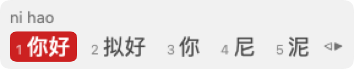
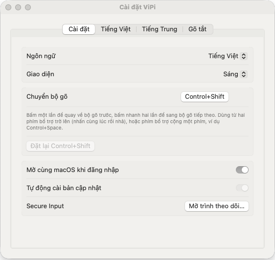
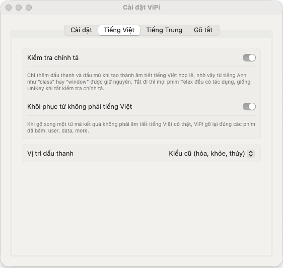
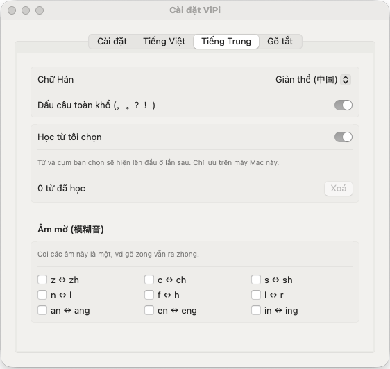
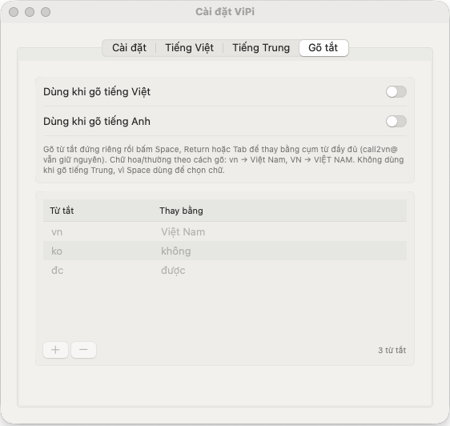

<h1 align="center">ViPi</h1>

  <b>Gõ tiếng Việt và tiếng Trung trên cùng một bàn phím Mac. Một phím tắt để đổi.</b> 
  Telex + Pinyin trong một app nhỏ trên thanh menu. Miễn phí, mã nguồn mở, chạy 100% offline.

  
  
  
  
  

  

<a href="README.md">English</a> · <b>Tiếng Việt</b> · <a href="README.zh-CN.md">简体中文</a>

  <picture>
    <source media="(prefers-color-scheme: dark)" srcset="assets/readme/hero-dark.png">
    
  </picture>

---

## 🤔 Vì sao nên dùng ViPi?

Nếu bạn viết cả tiếng Việt lẫn tiếng Trung, máy Mac của bạn có lẽ đang thế này:

- ❌ Một bộ gõ tiếng Việt, bộ Pinyin của Apple và ABC: **ba nguồn nhập, hai bộ gõ** giành nhau bàn phím
- ❌ ⌃Space xoay vòng qua tất cả, nên phải **bấm đi bấm lại** mới tới đúng ngôn ngữ
- ❌ Đang gõ câu tiếng Anh thì chữ bị biến thành tiếng Việt
- ❌ Bỗng một ngày mọi bộ gõ **không gõ được nữa** mà chẳng biết vì sao

**ViPi giải quyết hết:**

- ✅ **Một app, một phím tắt.** `⌃ Control` + `⇧ Shift` quay ngay về ngôn ngữ vừa dùng
- ✅ **Tiếng Anh vẫn là tiếng Anh.** `user`, `data`, `class` ra đúng như gõ, không cần chuyển bộ gõ
- ✅ **Pinyin ngay tại con trỏ.** Ô gợi ý hiện đúng chỗ đang gõ, gõ cả câu ra cả câu
- ✅ **Hết treo bí ẩn.** Công cụ theo dõi Secure Input chỉ đích danh app đang khoá bàn phím

## ⚡ Cài đặt trong chưa đầy một phút

1. **[Tải ViPi.dmg](../../releases/latest/download/ViPi.dmg)**, mở ra rồi kéo **ViPi** vào **Applications**.
2. Mở ViPi và cho phép trong **System Settings → Privacy & Security → Accessibility**. ViPi chạy ngay trong vòng 2 giây.
3. Bấm **`⌃ Control` + `⇧ Shift`** và gõ thôi. 🎉

> **Mẹo:** tắt các bộ gõ tiếng Việt khác (UniKey, EVKey, GoNhanh…) và chỉ giữ nguồn nhập **ABC**, để chỉ một mình ViPi xử lý phím gõ.

## ✨ Tính năng

### 🇻🇳 Telex nhanh như tay bạn gõ

| Bạn gõ | Bạn được | |
|:--|:--|:--|
| `tieengs Vieetj` | **tiếng Việt** | Telex kiểu UniKey: `aa` `aw` `ee` `oo` `ow` `uw` `dd`, dấu `s f r x j` |
| `tosan` | **toán** | gõ dấu ở đâu trong từ cũng được |
| `ass` | **as** | bấm một phím hai lần để bỏ dấu vừa gõ |
| `user data class` | **user data class** | gõ xong từ tiếng Anh là tự trả lại nguyên dạng |
| `vn` + Space | **Việt Nam** | gõ tắt theo danh sách của bạn, `VN` → `VIỆT NAM` |

- Đặt dấu kiểu cũ (`hòa`) hoặc kiểu mới (`hoà`), bật/tắt kiểm tra chính tả.
- **Nhanh và chắc:** đã thử trên máy Mac thật với đủ 8.329 âm tiết hợp lệ ở tốc độ 8–12 ms mỗi phím, cộng thêm 753 âm tiết trên Chrome ở 3 ms mỗi phím, không mất một phím hay một dấu nào.

### 🇨🇳 Pinyin có ô gợi ý thật sự

  <picture>
    <source media="(prefers-color-scheme: dark)" srcset="assets/readme/cand-dark.png">
    
  </picture>

| Bạn gõ | Bạn được | |
|:--|:--|:--|
| `nihao` | **你好** | pinyin đầy đủ, `v` = ü |
| `nh` | **你好** | chỉ gõ phụ âm đầu |
| `nih` | **你好** | âm cuối gõ dở vẫn ra chữ |
| `woshizhongguoren` | **我是中国人** | gõ cả câu một lần, mỗi từ chọn theo từ đứng trước (`wozaixuexi` → 我在学习, không phải 再) |
| `xi'an` | **西安** | `'` để tách âm |

`1`–`9` hoặc `Space` để chọn · `←` `→` di chuyển · `-` `=` hoặc `↑` `↓` lật trang · `Enter` gõ nguyên pinyin · `Esc` huỷ · dấu câu toàn khổ `，。？！`

- **Học theo bạn:** từ và cụm bạn chọn sẽ lên đầu ở lần sau. Chỉ lưu trên máy Mac của bạn, một nút để xoá.
- **Âm mờ (模糊音):** `z/zh` `c/ch` `s/sh` `n/l` `f/h` `l/r` `an/ang` `en/eng` `in/ing`, bật riêng từng cặp, nên gõ `zongguo` vẫn ra 中国.
- **Giản thể hoặc phồn thể:** một công tắc biến 头发 thành 頭髮 và 后天 thành 後天, hiểu theo cụm từ.

### ⌨️ Một phím tắt cho mọi ngôn ngữ

Bấm **`⌃ Control` + `⇧ Shift`** một lần để quay về bộ gõ trước, bấm nhanh hai lần để sang bộ tiếp theo. Thứ tự theo lần dùng gần nhất, giống ⌘Tab nhưng cho ngôn ngữ: **VI ⇄ 拼 ⇄ EN**. Thích Option+Shift hay Control+Space hơn? Đổi trong Cài đặt.

### 🛡️ Theo dõi Secure Input

Khi một ô mật khẩu hay cửa sổ terminal bật Secure Input của macOS, mọi bộ gõ đều im lặng. ViPi đổi biểu tượng trên thanh menu thành 🔒 và cho biết **app nào** đang giữ nó, kèm PID, đường dẫn, lịch sử và nút Show/Quit.

### 🎨 Hoà hợp với máy Mac của bạn

- **Ngôn ngữ của bạn:** toàn bộ giao diện có tiếng Anh, tiếng Việt và tiếng Trung giản thể.
- **Sáng hoặc Tối:** theo macOS hoặc tự chọn.
- **Tự cập nhật:** ViPi kiểm tra GitHub, xác minh bản tải về có chữ ký của nhà phát triển ViPi, cài đặt và khởi động lại khi bạn ngừng gõ.
- **Tự chạy khi đăng nhập**, nằm gọn trên thanh menu.

<table>
  <tr>
    <td><picture>
    <source media="(prefers-color-scheme: dark)" srcset="assets/readme/settings-general-vi-dark.png">
    
  </picture></td>
    <td><picture>
    <source media="(prefers-color-scheme: dark)" srcset="assets/readme/settings-vietnamese-vi-dark.png">
    
  </picture></td>
    <td><picture>
    <source media="(prefers-color-scheme: dark)" srcset="assets/readme/settings-chinese-vi-dark.png">
    
  </picture></td>
    <td><picture>
    <source media="(prefers-color-scheme: dark)" srcset="assets/readme/settings-shortcuts-vi-dark.png">
    
  </picture></td>
  </tr>
  <tr>
    <td align="center">Ngôn ngữ, giao diện, phím tắt</td>
    <td align="center">Chính tả và kiểu đặt dấu</td>
    <td align="center">Phồn thể, học từ, âm mờ</td>
    <td align="center">Gõ tắt</td>
  </tr>
</table>

## 🔒 Cam kết

- 🚫 **Không thu phí.** Miễn phí mãi mãi, giấy phép GPL-3.0, không có bản Pro.
- 🚫 **Không theo dõi.** Phím gõ được xử lý ngay trên máy và không bao giờ rời khỏi máy. Kết nối mạng duy nhất là kiểm tra cập nhật trên GitHub.
- 🚫 **Không quảng cáo, không tài khoản, không làm phiền.**
- ✅ **Có chữ ký và được Apple chứng thực (notarized)**, nên macOS mở không cảnh báo và quyền Accessibility được giữ nguyên qua các lần cập nhật.

## ❓ Hỏi đáp

<b>ViPi bỗng không gõ được trong mọi app</b>

Có app vừa bật Secure Input (ô mật khẩu, terminal bật "Secure Keyboard Entry", trình quản lý mật khẩu…). Biểu tượng trên thanh menu hiện 🔒. Mở **menu → Theo dõi Secure Input…** để xem app nào, rồi đóng ô đó hoặc thoát app đó.

<b>Một từ tiếng Anh bị biến thành tiếng Việt</b>

Những từ trùng với âm tiết tiếng Việt có thật, như `of` → `ò`, thì không thể tự phân biệt. Bấm phím dấu hai lần (`off` → `of`) hoặc chuyển sang tiếng Anh bằng `⌃ Control` + `⇧ Shift`.

<b>Có phải gỡ UniKey, EVKey hay GoNhanh không?</b>

Không cần, chỉ cần tắt chúng khi dùng ViPi. Hai bộ gõ cùng sửa một phím gõ sẽ giành nhau.

<b>ViPi chạy trên máy Mac nào?</b>

macOS 13 Ventura trở lên, cả chip Apple lẫn Intel.

<b>Gỡ ViPi thế nào?</b>

Chọn **Thoát ViPi** trong menu của nó, rồi kéo ViPi từ Applications vào Thùng rác.

## 💡 Vì sao có ViPi

Mình gõ tiếng Việt và tiếng Trung hằng ngày, nhưng trên macOS không có cách nào gõ cả hai cho hợp lý. Cách thường dùng là cài một bộ gõ tiếng Việt, thêm bộ Pinyin của Apple, cộng với tiếng Anh. Thế là phải chuyển qua lại giữa ba nguồn nhập, và hai bộ gõ còn hay giành bàn phím của nhau. ViPi gộp Telex và Pinyin vào một app nhỏ, chỉ cần một phím tắt để đổi ngôn ngữ.

ViPi còn mới. Gặp chỗ nào chưa ổn xin [báo ở Issues](../../issues). Nếu ViPi giúp bạn gõ nhẹ nhàng hơn, một ⭐ sẽ giúp người khác tìm thấy nó.

Muốn tự build? Xem [docs/development.md](docs/development.md).

## 📄 Giấy phép

GPL-3.0. Quy tắc Telex và bảng nguyên âm theo [UniKey](https://www.unikey.org) (GPL); từ điển Pinyin lấy từ [rime-ice](https://github.com/iDvel/rime-ice) (GPL-3.0); danh sách âm tiết tiếng Việt lấy từ [danh sách từ của Hồ Ngọc Đức](https://github.com/duyet/vietnamese-wordlist) (GPL); bảng chuyển giản→phồn thể lấy từ [OpenCC](https://github.com/BYVoid/OpenCC) (Apache-2.0); mô hình bigram từ rút từ mô hình ngôn ngữ của [libpinyin](https://github.com/libpinyin/libpinyin) (GPL-3.0). Ý nghĩa màu đỏ vàng, chữ V–P lồng nhau và ngôi sao trên logo xem ở [assets/logo-meaning.md](assets/logo-meaning.md).
