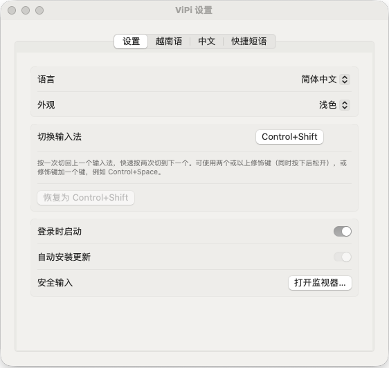
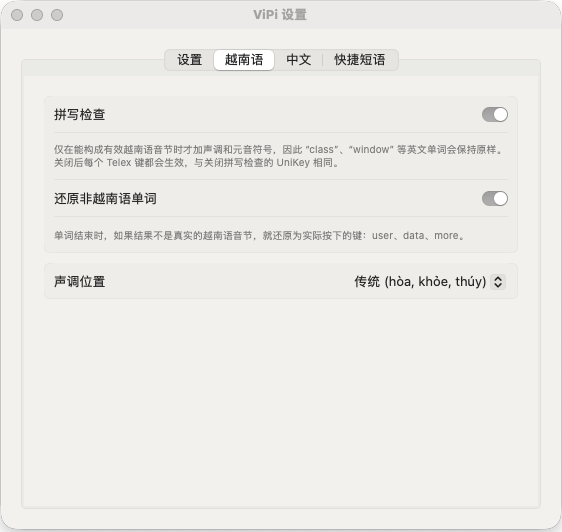
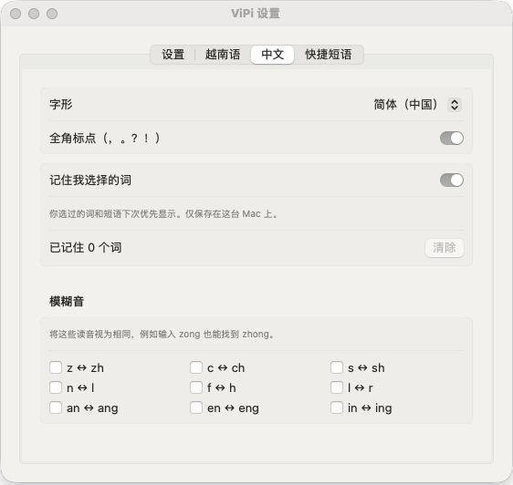
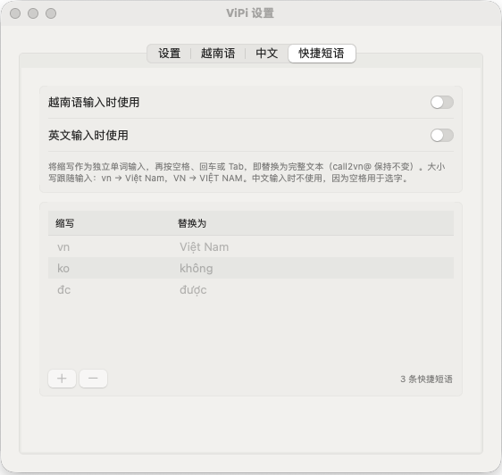

<h1 align="center">ViPi</h1>

  <b>一块 Mac 键盘，同时输入越南语和中文。一个快捷键切换。</b> 
  Telex + 拼音，装进一个小巧的菜单栏应用。免费、开源、100% 离线。

  
  
  
  
  

  

<a href="README.md">English</a> · <a href="README.vi.md">Tiếng Việt</a> · <b>简体中文</b>

  <picture>
    <source media="(prefers-color-scheme: dark)" srcset="assets/readme/hero-dark.png">
    
  </picture>

---

## 🤔 为什么选择 ViPi？

如果你既写越南语又写中文，你的 Mac 大概是这样的：

- ❌ 越南语输入法、苹果拼音、ABC：**三个输入源、两个输入法**抢同一块键盘
- ❌ ⌃Space 要在它们之间轮一圈，**按了又按**才切到想要的语言
- ❌ 正在打英文，单词却被变成了越南语
- ❌ 某天所有输入法突然**全都打不了字**，却不知道为什么

**ViPi 一次解决：**

- ✅ **一个应用，一个快捷键。** `⌃ Control` + `⇧ Shift` 立刻回到上一个用过的语言
- ✅ **英文就是英文。** `user`、`data`、`class` 原样输出，不用切换输入法
- ✅ **候选框就在光标旁。** 在哪里打字就在哪里选词，整句拼音一次转换
- ✅ **不再莫名卡死。** 安全输入监视器直接告诉你是哪个应用锁住了键盘

## ⚡ 一分钟上手

1. **[下载 ViPi.dmg](../../releases/latest/download/ViPi.dmg)**，打开后把 **ViPi** 拖进 **应用程序**。
2. 打开 ViPi，在 **系统设置 → 隐私与安全性 → 辅助功能** 中允许它。授权后 2 秒内即可使用。
3. 按下 **`⌃ Control` + `⇧ Shift`**，开始打字。🎉

> **提示：** 请关闭其他越南语输入法（UniKey、EVKey、GoNhanh…），只保留 **ABC** 输入源，让 ViPi 独自处理按键。

## ✨ 功能

### 🇻🇳 越南语 Telex，跟得上你的手速

| 你输入 | 你得到 | |
|:--|:--|:--|
| `tieengs Vieetj` | **tiếng Việt** | UniKey 风格 Telex：`aa` `aw` `ee` `oo` `ow` `uw` `dd`，声调 `s f r x j` |
| `tosan` | **toán** | 声调键放在词里任何位置都行 |
| `ass` | **as** | 同一个键按两次即撤销 |
| `user data class` | **user data class** | 词打完后自动还原英文单词 |
| `vn` + 空格 | **Việt Nam** | 自定义快捷短语，`VN` → `VIỆT NAM` |

- 传统（`hòa`）或新式（`hoà`）声调位置，可开关拼写检查。
- **又快又稳：** 在真实 Mac 上以每键 8–12 毫秒输入全部 8,329 个有效音节，另在 Chrome 中以每键 3 毫秒输入 753 个音节，没有丢失任何一个按键或声调。

### 🇨🇳 拼音，配真正的候选框

  <picture>
    <source media="(prefers-color-scheme: dark)" srcset="assets/readme/cand-dark.png">
    
  </picture>

| 你输入 | 你得到 | |
|:--|:--|:--|
| `nihao` | **你好** | 全拼，`v` = ü |
| `nh` | **你好** | 简拼（只打声母） |
| `nih` | **你好** | 最后一个音节没打完也能出字 |
| `woshizhongguoren` | **我是中国人** | 整句一次输入，按上下文选词（`wozaixuexi` → 我在学习，而不是 再） |
| `xi'an` | **西安** | 用 `'` 分隔音节 |

`1`–`9` 或 `空格` 选词 · `←` `→` 移动 · `-` `=` 或 `↑` `↓` 翻页 · `回车` 输入原始拼音 · `Esc` 取消 · 全角标点 `，。？！`

- **越用越懂你：** 你选过的词和短语下次优先显示。仅保存在你的 Mac 上，一键清除。
- **模糊音：** `z/zh` `c/ch` `s/sh` `n/l` `f/h` `l/r` `an/ang` `en/eng` `in/ing`，逐项可选，输入 `zongguo` 也能找到中国。
- **简体或繁体：** 一个开关，头发变 頭髮、后天变 後天，按词组转换。

### ⌨️ 一个快捷键，切换所有语言

按一次 **`⌃ Control` + `⇧ Shift`** 回到上一个输入法，快速按两次切到下一个。按最近使用顺序排列，就像给语言用的 ⌘Tab：**VI ⇄ 拼 ⇄ EN**。更喜欢 Option+Shift 或 Control+Space？在设置里随时修改。

### 🛡️ 安全输入监视器

密码框或终端开启 macOS 安全输入（Secure Input）时，所有输入法都会失效。ViPi 会把菜单栏图标变成 🔒，并告诉你**是哪个应用**占用了它，附带 PID、路径、历史记录和“显示 / 退出”按钮。

### 🎨 与你的 Mac 浑然一体

- **你的语言：** 整个界面支持 English、Tiếng Việt 和简体中文。
- **浅色或深色：** 跟随系统，或自己选择。
- **自动更新：** ViPi 从 GitHub 检查新版本，验证下载文件确实由 ViPi 开发者签名，安装后在你停止打字时自动重启。
- **登录时自动启动**，安静地待在菜单栏。

<table>
  <tr>
    <td><picture>
    <source media="(prefers-color-scheme: dark)" srcset="assets/readme/settings-general-zh-dark.png">
    
  </picture></td>
    <td><picture>
    <source media="(prefers-color-scheme: dark)" srcset="assets/readme/settings-vietnamese-zh-dark.png">
    
  </picture></td>
    <td><picture>
    <source media="(prefers-color-scheme: dark)" srcset="assets/readme/settings-chinese-zh-dark.png">
    
  </picture></td>
    <td><picture>
    <source media="(prefers-color-scheme: dark)" srcset="assets/readme/settings-shortcuts-zh-dark.png">
    
  </picture></td>
  </tr>
  <tr>
    <td align="center">语言、外观、快捷键</td>
    <td align="center">拼写检查与声调位置</td>
    <td align="center">繁体、记忆选词、模糊音</td>
    <td align="center">快捷短语</td>
  </tr>
</table>

## 🔒 我们的承诺

- 🚫 **不收费。** 永久免费，GPL-3.0 许可，没有 Pro 版。
- 🚫 **不追踪。** 按键只在你的 Mac 上处理，绝不外传。唯一的联网行为是向 GitHub 检查更新。
- 🚫 **没有广告、无需账号、不打扰。**
- ✅ **已签名并通过 Apple 公证**，macOS 打开时不会弹出警告，更新后辅助功能权限依然保留。

## ❓ 常见问题

<b>ViPi 突然在所有应用里都打不了字</b>

某个应用开启了安全输入（密码框、开启“安全键盘输入”的终端、密码管理器…），菜单栏图标会显示 🔒。打开 **菜单 → 安全输入监视器…** 查看是哪个应用，然后关闭那个输入框或退出该应用。

<b>英文单词被打成了越南语</b>

有些英文单词本身也是合法的越南语音节，例如 `of` → `ò`，无法自动区分。把声调键按两次（`off` → `of`），或用 `⌃ Control` + `⇧ Shift` 切到英文。

<b>需要卸载 UniKey、EVKey 或 GoNhanh 吗？</b>

不需要，使用 ViPi 时把它们关掉即可。两个输入工具同时改写按键会互相冲突。

<b>支持哪些 Mac？</b>

macOS 13 Ventura 及以上，Apple 芯片和 Intel 均可。

<b>如何卸载？</b>

在 ViPi 菜单中选择 **退出 ViPi**，然后把 ViPi 从“应用程序”拖到废纸篓。

## 💡 为什么做 ViPi

我每天都要输入越南语和中文，可在 macOS 上一直没有顺手的方案：通常要装一个越南语输入法，再加上苹果自带的拼音和英文，三个输入源来回切换，两个输入法还会互相抢键盘。ViPi 把 Telex 和拼音放进一个小巧的应用，一个快捷键就能切换语言。

ViPi 刚刚发布，如有不顺手的地方，欢迎在 [Issues](../../issues) 反馈。如果它让你打字更轻松，点个 ⭐ 能帮更多人找到它。

想自己构建？请看 [docs/development.md](docs/development.md)。

## 📄 许可证

GPL-3.0。Telex 规则和元音表参照 [UniKey](https://www.unikey.org)（GPL）；拼音词库来自 [rime-ice](https://github.com/iDvel/rime-ice)（GPL-3.0）；越南语音节表源自 [胡玉德（Hồ Ngọc Đức）的词表](https://github.com/duyet/vietnamese-wordlist)（GPL）；简繁转换表来自 [OpenCC](https://github.com/BYVoid/OpenCC)（Apache-2.0）；词语二元模型源自 [libpinyin](https://github.com/libpinyin/libpinyin) 的语言模型（GPL-3.0）。Logo 的红金配色、V–P 连笔和星星的含义见 [assets/logo-meaning.md](assets/logo-meaning.md)。
